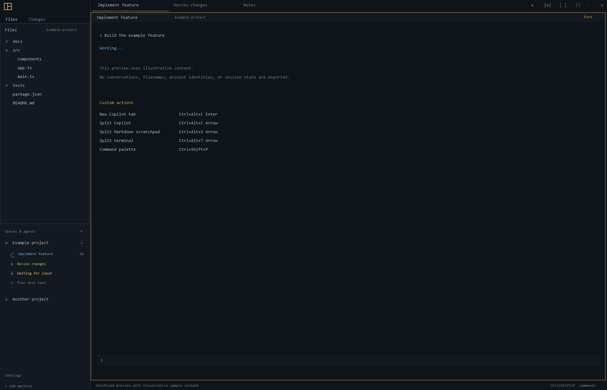

# Tiled agent workspace for Herdr

A custom Herdr layout with a Files sidebar, grouped agent tree, compact tiled terminals, conversation forks, Markdown scratchpads, and a gold-accented command palette.
The preview is an illustrative, sanitized rendering with sample content, not actual session data.



## Requirements

| Dependency | Requirement |
| --- | --- |
| Herdr desktop app | Tested baseline `herdr-app 0.1.15`, with its shipped mods and icons already installed |
| Herdr core | Tested baseline `hc 0.1.21`, available on `PATH` |
| Node.js and Git | Available on `PATH` for directory enumeration, helper processes, and Git badges |
| Copilot CLI | Installed and signed in, available on `PATH`; authenticate separately |
| PowerShell | PowerShell 7 (`pwsh`) for installation and Windows process inspection |
| Operating system | Windows for the complete layout, scratchpad paths, and conversation forks |
| Fonts | Geist Mono if available; Herdr's installed font fallback otherwise |

Stock dependencies are required from the recipient's Herdr installation, not redistributed.
The exact file requirements are listed in [bundle.json](bundle.json).
Different Herdr or Copilot versions may require rebuilding from [RECIPE.md](RECIPE.md).

## Review before installing

Read the [recipe](RECIPE.md), [attribution](ATTRIBUTION.md), and bundled source before installation.
This package executes Node.js, Git, PowerShell, `hc`, and `herdr-app` when its controls are used.
Copilot creation and fork controls launch Copilot only after a user action.
The explorer reads the focused workspace and previews selected files.
Scratchpads write only when Save or Replace file is clicked.
The fork helper inspects local Windows processes and reads Copilot session metadata and event logs under the current user's home directory.
Forking asks Copilot to create a real independent conversation and briefly runs a disposable helper terminal.
The copied mods make no direct network requests, but Copilot, remote core connections, and shipped Herdr features may access the network.

No sessions, terminal contents, private folders, credentials, settings, program definitions, or mod data are included.
The installer never launches Copilot.
All bundled Copilot argv arrays retain `--disable-builtin-mcps` and omit `--yolo`, preserving approval prompts.

## Install

Close Herdr before copying files so hot reload cannot observe an incomplete installation.
Run these commands from the cloned repository in PowerShell 7.
The target must already contain the stock Herdr mods and assets.
The default target is `HERDR_APP_HOME`, if set, otherwise the current user's `.config\herdr-app`.

```powershell
$homePath = Join-Path $HOME '.config\herdr-app'
.\Install.ps1 -HerdrHome $homePath -DryRun
```

An existing stock `Ctrl+Shift+P` palette binding is an expected conflict.
The first command reports conflicts without changing any files.
Review the reported replacements, then explicitly allow the bundled bindings to replace conflicting global keys:

```powershell
.\Install.ps1 -HerdrHome $homePath -DryRun -ReplaceConflictingKeys
.\Install.ps1 -HerdrHome $homePath -ReplaceConflictingKeys
```

`-ReplaceConflictingKeys` authorizes only replacements at keys present in this bundle, not file or mod overwrites.
Other recipient bindings and the entire terminal section are preserved.
Terminal mapping conflicts and overlapping chord prefixes are always rejected, even with this flag.
Resolve those by deliberately remapping the bundle or recipient keys before retrying.
Menu and palette shortcut hints read the installed bindings.

Existing layout, theme, or custom mod names are always rejected before writing.
The installer intentionally does not rename mods because their internal command and asset references must remain consistent.
There is no implicit rerun, update, or overwrite mode.

The installer stages the allowlisted files, runs native checks, backs up the exact original keys, copies the package, merges keys, and checks the installed mods again.
Failure rolls back copied files and keys and removes staging.
Generated API typings and editor config created by checks are removed if they did not already exist.
A successful install prints the path of `keys.before-herdr-layout-<id>.json`; keep this original-key backup.
No recipient shared, data, view, window, settings, or session-state files are edited.
Do not edit recipient keys or install another package concurrently.

## Activate and use

Installation leaves the active layout unchanged.
Open Herdr normally and use `Ctrl+Shift+L` to select `files-left`.
For a custom home, start Herdr with the matching `HERDR_APP_HOME`.

```powershell
$env:HERDR_APP_HOME = $homePath
herdr-app
```

Optional activation requests a layout switch in an already running window for the chosen home:

```powershell
.\Install.ps1 -HerdrHome $homePath -ReplaceConflictingKeys -Activate
```

Use `-Activate` on the initial installation, not a rerun.
Unlike ordinary installation, activation changes the running window's selected layout.
If activation fails, the error explicitly says the files remain installed; open the matching window and select the layout manually.

| Binding | Action |
| --- | --- |
| `Ctrl+Shift+P` | Open the command palette |
| `Ctrl+Alt+C`, then `Enter` | New Copilot agent in the current space |
| `Ctrl+Alt+C`, then an arrow | Copilot split in that direction |
| `Ctrl+Alt+S`, then an arrow | Markdown scratchpad split in that direction |
| `Ctrl+Alt+T`, then an arrow | Terminal split in that direction |
| `Ctrl+Alt+F` | Fork the focused Copilot conversation into a right-hand pane |
| `Ctrl+Alt+N` | New space with an agent or terminal chooser |
| `Ctrl+Alt+E` | Toggle Files |
| `Ctrl+Alt+G` | Toggle Changes |

These are sequential chords, not simultaneous letter-and-arrow presses.
The Ctrl+Alt family deliberately avoids the existing `Ctrl+Shift+C` terminal copy binding.
Changing bindings does not require changing the command dispatch implementation.

Each split button creates a right-hand pane; its adjacent chevron chooses Right, Left, Up, or Down.
The Copilot icon starts a new tab.
The ordinary plus button opens Herdr's shipped new-tab menu, whose launch choices remain recipient-controlled.
Space headers select spaces; their chevrons fold groups and their plus buttons choose an installed agent or terminal.
Hover an agent to pin or unpin it.
Click files to open read-only previews in right-hand tiles.
Scratchpads offer Edit, Preview, Save, and explicit existing-file replacement.
Save before closing a scratchpad; unsaved buffers are not recovered.

## Approval behavior and explicit opt-in

The default package does not bypass Copilot approvals.
Startup trust or consent prompts can prevent the disposable fork helper from completing within its 20-second acknowledgment deadline.
Resolve trust interactively outside the installer, or use ordinary new-agent creation when a fork cannot complete.
The helper reports failure rather than treating a fresh conversation as a verified fork.

If you explicitly want unrestricted Copilot execution, manually add the string `"--yolo"` immediately after `"--disable-builtin-mcps"` in the argv arrays in these installed files:

| File | Launch site |
| --- | --- |
| `mods\agents-titles\main.js` | `COPILOT_ARGS` for the space chooser |
| `mods\custom-palette\actions.js` | `COPILOT_ARGS` for custom actions |
| `mods\tabs-tiling\splits.js` | `COPILOT_ARGS` for tab and split controls |
| `mods\pane-fork\fork.js` | Resumed fork pane argv |
| `mods\pane-fork\fork.cjs` | Disposable fork-helper argv |

This is an explicit local code edit, not an installer option or a requirement.
It enables unrestricted execution and is not recommended as a default.
Leave `--disable-builtin-mcps` intact.
The toolbar tooltips derive from the installed argv, so no separate tooltip edit is needed.
Re-run native checks after any edit.

## Uninstall and update

Switch to another layout with `Ctrl+Shift+L`, then close Herdr.
Verify that the names below still belong to this package before removing them.
Remove only the allowlisted layout, theme, and eight custom mod directories:

```powershell
$bundle = Get-Content .\bundle.json -Raw | ConvertFrom-Json -AsHashtable
Remove-Item -LiteralPath (Join-Path $homePath "layouts\$($bundle.layout).json")
Remove-Item -LiteralPath (Join-Path $homePath "themes\$($bundle.theme).json")
foreach ($name in $bundle.mods.Keys) {
    Remove-Item -LiteralPath (Join-Path $homePath "mods\$name") -Recurse
}
```

If keys have not been edited since installation, restore `keys.json` from the exact backup path printed by the installer.
If keys have changed, merge manually: remove only bindings still matching this bundle and restore overwritten bindings from the backup.
Do not replace newer personal bindings with an old complete key backup.
Keep all stock mods, settings, shared state, workspace data, and Copilot sessions.
Uninstalling does not delete Markdown files saved from scratchpads.

For an update, back up any local custom-mod edits, uninstall the previous package, and install the new revision.
The default name-collision rejection protects those edits.

## Validate locally

The repository has no Rush workspace or `docs:lint` command.
Do not add unrelated package tooling solely to run that command.

```powershell
pwsh -NoProfile -File .\tests\Install.Tests.ps1 -StockHome $homePath
node --test .\tests\palette.test.cjs .\tests\scratchpad.test.cjs .\tests\titles.test.cjs
herdr-app check .\mods\custom-palette
```

The installer tests use explicitly named homes under `tests\.homes` and remove them afterward.
They never activate a layout, launch Copilot, or edit the supplied stock home.
Native `check` creates editor typings beside the checked mod; they are generated tooling, not distributable bundle inputs.
The installer handles their cleanup automatically.

## Constraints and provenance

The explorer supports local Windows folders and selected remote contexts, but the full package is Windows-focused.
Forks require local Windows Copilot panes, PowerShell process visibility, compatible Copilot session metadata, and an idle source conversation.
Scratchpads accept local Windows drive or UNC paths and do not offer remote saving.
The original layout clone and shipped-derived mod provenance are preserved at Herdr `0.1.15`.
The sidebar uses an original neutral terminal/tile mark, not a product logo.
See [ATTRIBUTION.md](ATTRIBUTION.md) for upstream licenses, modification notices, and the publication audit's limits.
