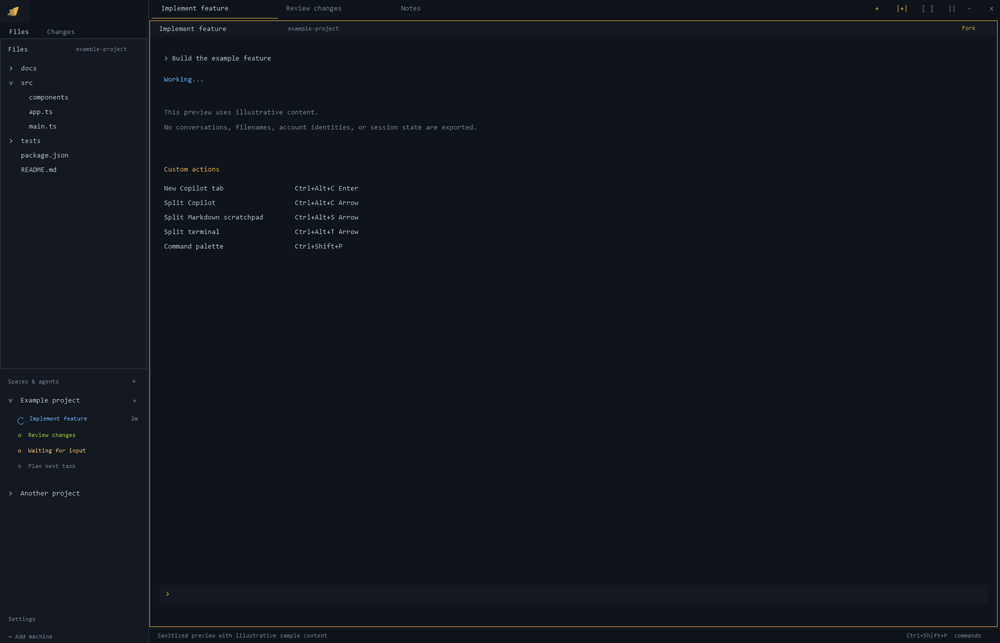

# Tiled agent workspace

A dark, gold-accented Windows workspace with a theme-tinted fan mark above a Files sidebar and grouped agent tree, compact conversation tabs, equally balanced terminal tiles, Markdown scratchpads, and a command palette.
The preview is illustrative and sanitized; all project, agent, filename, and conversation content is sample content.

## What you see

The window uses no native titlebar and has a 268 px sidebar that can collapse to a 44 px Windows rail.
The sidebar's allowed width range is 44 to 480 px; widths below 160 px use compact rail rendering.
The overall font is Geist Mono at 14 px, with mostly 11 to 13 px UI labels.
The canvas is `#10141c`, chrome and popovers are `#141821`, borders and raised surfaces are `#1b1f29`, muted text is `#7a8490`, foreground is `#bfbdb6`, and the accent is `#e6b450`.

| Region | Size and content |
| --- | --- |
| Sidebar mark | 46 px high, 24 px three-leaf fan tinted with the current theme accent, picker and collapse buttons |
| Files/Changes switch | 30 px high, two compact 24 px controls |
| Files/Changes panel | Initially shown with Files selected, flexible weight 1 and 90 px minimum |
| Spaces and agents | Flexible weight 1 and 90 px minimum, 41 px title header, 32 px space headers, 30 px agent rows, 26 px nested rows |
| Sidebar footer | 69 px high, shipped Settings and Add machine controls |
| Tabs and controls | 37 px high, active gold underline, tab names limited to 170 px, compact 26 px launch and split buttons |
| Work area | Flexible terminal/mod tiles, 4 px outer padding and gaps |
| Pane header | Always visible at the top, 30 px high, agent label, folder, status, and Fork control |
| Status strip | 26 px high, machine, branch, agent count, attention count, and installed palette-key hint |
| Command palette | Top popup, 680 px wide, up to 85% window height, 32 px result rows and 26 px group headings |

Pane borders are 1 px with square corners and a gold focus border.
Terminal padding is 12 px vertically and 14 px horizontally inside the main pane region.
The base layout also supplies 14 px vertically and 12 px horizontally as its fallback terminal padding.
Changes use the shipped viewer, not a rewritten Git interface.

## How it behaves

| Agent state | Appearance and priority |
| --- | --- |
| Working | Blue `#6cb6ff` spinner rotating every 900 ms in tree, tab, and pane header |
| Blocked | Gold `#ffd173` text or dot, Needs you badge in the pane, highest urgency |
| Done | Green `#aad94c` text or dot, next urgency |
| Idle | Muted `#7a8490`, lowest urgency |

Pins sort first inside each space, then urgency, the most recent state change, and sequence.
Live descendants contribute to their parent's urgency.
A child error counts as blocked and a child's done state is treated as idle because its parent owns completion.
Nested agents draw tree connectors and are not duplicated as root rows unless pinned.
Folded trees show descendant counts colored by their most urgent status.
The displayed agent order is also the keyboard navigation order.
Pins use core terminal labels; old local pins migrate only after the core confirms the label.
State timestamps and folds are remembered by the mod at runtime, not shipped as user data.

Click an agent or pane header to focus it.
An unshown child opens a terminal peek.
Right-click tabs, agents, or spaces for the shipped contextual menu.
Space chevrons fold groups without changing focus; the space row itself selects the space.
Space plus buttons discover installed agents, with Copilot using the bundled safe launch argv.
The top tree plus opens a new-space chooser.
Number keys in that chooser select the corresponding installed agent.
No folder or no focused pane yields a visible error rather than a speculative launch.

Automatic conversation titles are cleaned of leading status glyphs and the GitHub Copilot suffix.
Explicit custom tab names win unless they are only the program name.
Shell paths, generic names, and user-at-host titles do not replace meaningful tab labels.
A multi-agent tab uses a stable lead agent in the tab bar and each agent's own title in the tree and pane header.

Tab clicks select, double-clicks rename, pointer movement from one tab to another reorders, and the active close button closes a tab.
The active tab stays in view while labels or status icons change.
The Copilot icon starts a new Copilot tab.
Each split button defaults to Right; its chevron offers Right, Left, Up, and Down.
Left and Up are implemented as a real split followed by a pane swap.
Added or removed tiles trigger proportional split-tree weights based on descendant leaf counts, so all leaves have equal area.

Files follows the focused pane's working folder with per-tab fallback and cached folder expansion.
Folders load lazily; Git badges appear alongside changed filenames.
Files open read-only right-hand previews, including Markdown Preview and Source modes.
Directory watches coalesce refreshes, with a 10-second fallback refresh.
Files and Changes toggle each other through the same stack, and clicking the active choice hides the panel.
The panel choice is remembered per space.
The first clean activation starts with Files shown; an existing recipient space preference can override it.

Scratchpads begin as unsaved Markdown with an `Untitled.md` save-path suggestion in the current space's folder.
Edit and Preview share the same unsaved source buffer.
An existing file requires an explicit Replace file confirmation.
All saves compare against the last observed file contents, so concurrent edits fail without clobbering them.
Closing a scratchpad does not recover its unsaved buffer.

Fork acts only on an idle local Copilot conversation.
It identifies the owning process and locked session, asks Copilot to fork into a uniquely named conversation, verifies the acknowledged independent session and copied ancestry, and resumes that session in a right-hand pane.
It cleans up only its disposable helper terminal.
It does not fake a fork by starting a blank agent.
A created fork whose pane cannot open remains saved, with its session ID reported in the error.

The command palette pins custom actions in gold before recent and standard actions.
Fuzzy search preserves that priority among matching actions.
Enter executes, arrows move, Page Up and Page Down move ten rows, Escape closes, and scrolling keeps selection visible.
The installed `keys.json` supplies hints; hints are not hardcoded shortcut promises.
The default bindings are Ctrl+Shift+P for the palette and sequential Ctrl+Alt chords for custom actions, as listed in [README.md](README.md).
The status strip remains alive to dispatch custom key commands after the palette closes.

## Built from

| Layout node | Type and content |
| --- | --- |
| `root` | Row containing `sidebar` and `work` |
| `sidebar` | Column containing `brand`, `sidebar-lists`, and `sidebar-footer` |
| `brand` | Block using `layout-chrome` |
| `sidebar-lists` | Column containing `panel-switch`, `panel`, and `agents` |
| `panel-switch` | Block using `files-switch` |
| `panel` | Column containing stack `panel-body` |
| `panel-body` | Stack with `files` using `files-tiled` and `changes` using shipped `changes`, active `files` |
| `agents` | Block using `agents-titles` |
| `sidebar-footer` | Block using shipped `workspace-chrome` with `props.footer: true` |
| `work` | Column containing `tabs`, `work-body`, and `status` |
| `tabs` | Block using `tabs-tiling` |
| `work-body` | Row containing `main`, whose content is the active tab |
| `main` pane header | `pane-fork`, always revealed, top position and 30 px height |
| `status` | `custom-palette` with required `props.status: true` |

Use the included `themes\aurum.json` and `layouts\files-left.json` as the exact color and sizing inputs.
The layout is cloned from shipped `main` at version `0.1.15`.
The complete runtime source and asset allowlist is [bundle.json](bundle.json).

| Custom mod | Roles and interfaces |
| --- | --- |
| `layout-chrome` | Theme-tinted fan mark, picker and rail toggle; `layout`, `shared`, `setShared`, `window`, `updates`, `run` |
| `files-switch` | Layout stack selection and visibility via `layout.select`, `layout.show`, and `layout.hide` |
| `files-tiled` | Tree and read-only preview; `props.preview`, `root`, `path`, `on`; `spaces`, `panes`, `focused`, `exec`, `readTextFile`, `watchFolder`, `pane.split` |
| `agents-titles` | Space tree, statuses, pins and ordering; `props.spaceMenu`, `space`, `newSpace`, `machine`; `agents`, `terminals`, `knownAgents`, `setAgentOrder`, `terminal.pin` |
| `tabs-tiling` | Tab bar, launch controls, balancing and split-menu overlay; `props.splitMenu`, `kind`, `pane`, `folder`; `pane.split`, `pane.swap`, tab commands, `shared`, `exec` |
| `pane-fork` | Pane headers and persistent fork dispatch; `props.pane`, `appHome`, `exec`, `notify`, focus/split/close commands |
| `custom-palette` | Palette overlay and persistent status view; `commands`, `layouts`, `keys`, `nextCommand`, `run`, `openOverlay`, `closeOverlay`, `shared`, `setShared` |
| `scratchpad-markdown` | Markdown editor and local explicit save; `props.folder`, `readTextFile`, `writeTextFile` with expected contents |

All UI modules use Herdr's `gpui-kit` and `gpui-base` runtime.
Relative helpers remain inside each mod because cross-directory JavaScript imports are unsupported.
Shared request keys `tabs-tiling.split-request` and `pane-fork.request` hand work to persistent views.
The split request captures the target pane before closing the popup or palette.
Balancing reads the `herdr-app` core document through a Node `hc connect` JSON-RPC helper, then calls `herdr-app do layout.resize` for each proportional weight.
Explorer enumeration uses Node on Windows, a bounded PowerShell fallback, or `sh` on supported remote contexts.
Git badges use read-only Git status with optional locks and fsmonitor disabled.
The fork helper uses Node, `pwsh.exe` process inspection, `hc`, and the detected Copilot executable.
Copilot argv retains `--disable-builtin-mcps` without `--yolo` in every bundled launch site.

Shipped dependencies include Changes, workspace chrome, the new-tab menu, contextual menu, picker, prompt, machine-add, file and pane assets, and Copilot/shell icons.
Do not clone unused stock folders or copy runtime editor typings.
`scratchpad-space` is clone provenance only, not a runtime dependency.
The three-leaf fan uses a theme-tinted SVG mask with distinct leaf opacities, not fixed product colors.
Shipped-derived code and glyphs retain the attribution in [ATTRIBUTION.md](ATTRIBUTION.md).

## Watch out

Keep `custom-palette` mounted with `props.status: true`; removing it breaks custom command dispatch when no overlay is open.
Do not run asynchronous split work in the closing popup: its tasks are canceled with that view.
Render schedules dispatch after the frame; avoid mutating the active view recursively during rendering.
Keep split and fork requests single-flight and report busy states.
Do not overwrite recipient keys or custom names without explicit consent.
The installer rejects file/mod collisions rather than attempting incomplete internal renames.

Limit explorer folders to 500 entries each and 5,000 total entries, four concurrent directory loads, eight retained entry caches, and tree depth 40.
Use a virtual 28 px file-row list and 250 ms watch coalescing.
Throttle Git status to at most once per two seconds.
Previews display at most 400,000 characters, although the file read occurs before that display truncation.
Binary files and read failures show errors instead of editable content.

The palette shows ten 32 px rows in its scrolling result area and stores at most twenty recent entries.
Absolute row-edge positioning avoids cumulative rounding drift at zoomed scales.
Balancing tries up to three snapshots when a pane mutation has not yet been saved and reports partial resize failures.
Do not force equal half-sizes at every branch; weight each branch by its descendant leaf count.

Forks require local Windows Copilot panes and readable executable paths and session locks.
The helper path uses `appHome()` followed by `\mods\pane-fork\fork.cjs`, not an author's fixed home.
A remote machine address is rejected for forks.
Fork acknowledgment must arrive within twenty seconds.
Approval or workspace trust prompts can delay the helper when unrestricted mode is disabled; do not silently re-enable it.
Scratchpad paths are local Windows drive or UNC paths, even if the current space is remote.
Unsaved scratchpad text is not persisted or protected by a close confirmation.
Shipped menus keep the recipient's own launch choices; this package does not rewrite global program definitions.

## Done when

1. Every bundled mod passes native `herdr-app check`.
2. Installation into a separate named home preserves recipient settings, shared state, data, terminal mappings, and unrelated keys.
3. Default key/name conflicts and native validation failures leave the recipient unchanged.
4. Explicit global key replacement keeps an exact original-key backup, and a post-copy failure rolls back all copied files and keys.
5. A clean activation shows Files, the space tree, compact tabs, pane headers, and the status strip with the included theme.
6. New-agent and each directional split action use the captured target pane and preserve Ctrl+Shift+C copy.
7. Adding or removing unequal nested splits leaves terminal tiles with equal area.
8. Working spinners, blocked/done/idle colors, child urgency, pins, folds, ordering, and conversation titles remain correct.
9. File expansion stays bounded and opens correct read-only previews; a scratchpad's concurrent save fails without overwriting the other writer.
10. On a trusted compatible local Copilot setup, an idle conversation forks into a verified distinct resumable session and its disposable helper disappears.
11. The closed palette's custom shortcuts still work through the persistent status instance.
12. No automatic Copilot launch, unrestricted argv, recipient private data, or hardcoded author home is introduced.
